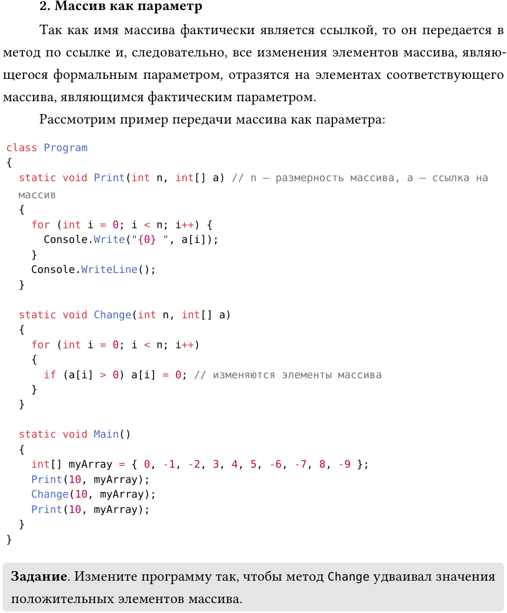

# Лабораторная работа №2: Массивы в C#

Проект содержит решения трёх заданий по работе с массивами (одномерными и ступенчатыми).

## Задание 1. Ввод массива и удвоение положительных
Пользователь вводит массив с клавиатуры, программа сортирует его по возрастанию и убыванию. Также демонстрируется работа со случайным массивом.

## Задание 2. Ступенчатый массив с правилом
Создание ступенчатого массива, где длина каждой строки `i` равна `i * 2`, а элементы равны сумме индексов строки и столбца (`i + j`).

## Задание 3. Сумма элементов по столбцам
Дан квадратный ступенчатый массив `n × n`. Для каждого столбца считается сумма чётных положительных элементов.

## Стек
- C# (.NET 10)
- Консольное приложение
